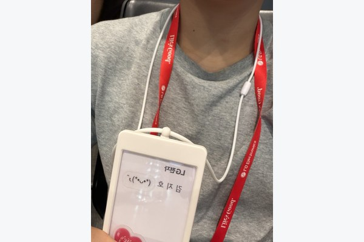
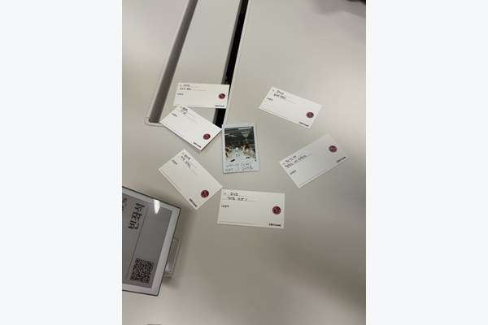
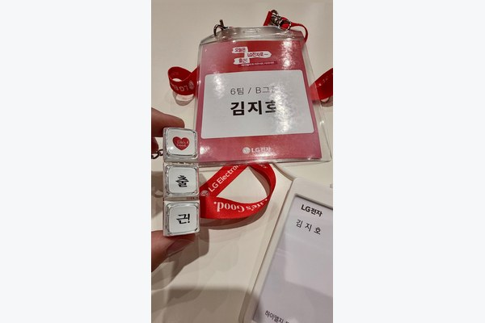
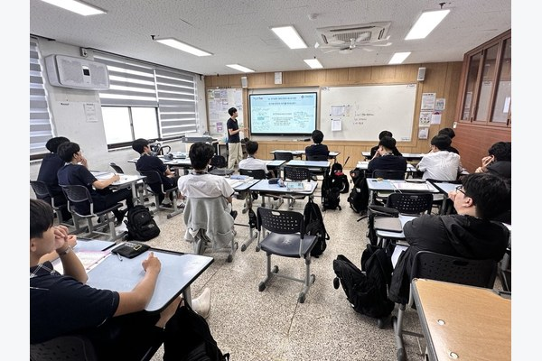
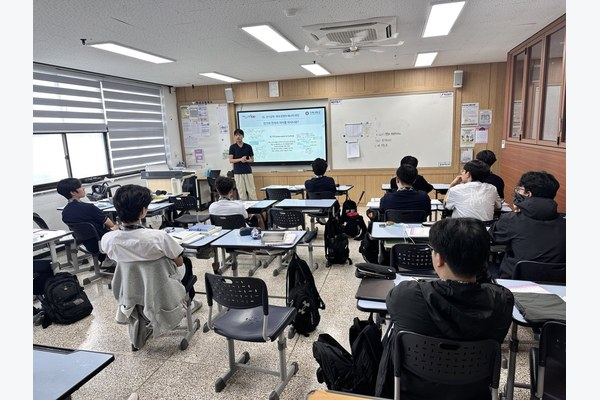
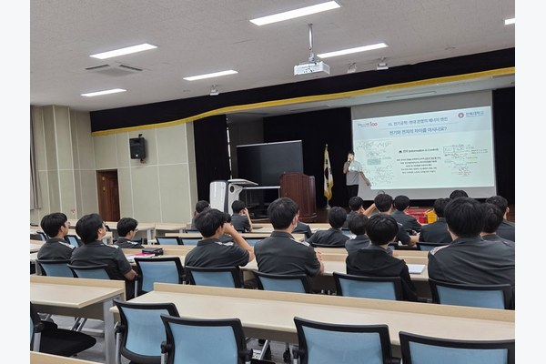
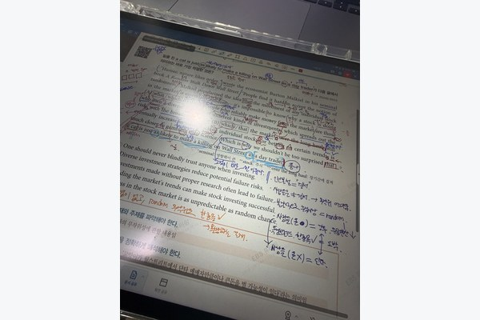
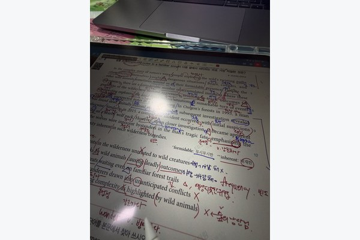
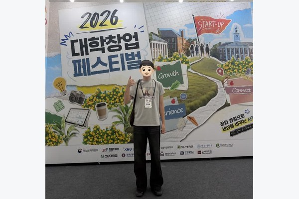

# 대외활동

[LG전자](#lg전자-하이엘지-토크콘서트) · [전공알리GO](#전공알리go-전공알림단) · [EBS 튜터링](#ebs-튜터링) · [대학창업페스티벌](#대학창업페스티벌)

사진을 누르면 원본을 크게 볼 수 있습니다.

| 활동 내용 | 기관·활동 |
| --- | --- |
| 초등학생 대상 교통안전 교육 진행 · 장학금 수혜 | 한국도로공사 전북본부 배움잇는 인턴십 · 2026년 여름방학 |
| 현직자 직무 탐색 · AX 업무혁신 사례 학습 · 피지컬 AI와 전공 연결 | [LG전자 하이엘지 토크콘서트 커리어편 · 2026.07.21](#lg전자-하이엘지-토크콘서트) |
| 창업팀 발표·질의응답 기록 및 사업성 분석 | [창업중심대학 대학창업페스티벌 · 2026.09.17](#대학창업페스티벌) |
| 전북대학교를 통해 학술대회 참관 · 제주국제컨벤션센터 | 2026 한국자동차공학회 춘계학술대회 · 2026.05.20–23 |
| 전북 지역 고등학생 대상 전기공학 전공 소개 및 진학 상담 | [전북대학교 전공알리GO 전공알림단 · 2026.07.01–08.28](#전공알리go-전공알림단) |
| 고1 영어 2명 · 중3 수학 1명 지도 | [EBS 튜터링 · 2026년 2학기 진행 중](#ebs-튜터링) |
| 학교 밖 청소년의 검정고시 학습 지도 | 학교밖청소년지원센터 |
| 진로·감정코칭 프로그램 진행 보조 | 김제시청소년상담복지센터 |
| 센터 아동 학습 보조 | 김제시다함께돌봄센터 |
| 팀장으로 중국인 학생 2명과 매주 스터디 진행 | 전북대학교 글로벌 스터디그룹 · 2026년 1학기 |

## LG전자 하이엘지 토크콘서트

**커리어편 · 2026.07.21 · LG사이언스파크 · 대학생 참가자**

**현직자의 이야기를 통해 R&D 직무를 이해하고, 제가 연구한 모터제어 기술이 피지컬 AI 시대에 어떻게 활용될 수 있을지 생각해 본 경험입니다.**

### 1. 현직자에게 배운 커리어 설계의 기준

가장 기억에 남은 이야기는 **전공과 첫 직무가 평생의 직무를 결정하지는 않는다**는 것이었습니다. 현직자들은 대외활동을 많이 하는 것 자체보다, 다양한 경험 속에서 자신이 어떤 일을 좋아하고 어떤 방식으로 일하는 사람인지 알아가는 과정이 중요하다고 말했습니다. 다만 그 과정에서도 학점과 전공 기초를 놓치지 않아야 하며, 이공계 학생에게는 학부연구처럼 기획·개발·제어·시험 과정을 경험해 보는 활동이 큰 자산이 된다는 조언이 인상적이었습니다.

저 역시 여러 경진대회에 참여해 왔지만, 활동의 개수보다 **그 경험을 통해 무엇에 흥미를 느꼈고 어떤 역량을 쌓았는지 설명할 수 있어야 한다**는 점을 배웠습니다. 특히 PMSM 모터제어 학부연구에서 직접 회로와 제어 과정을 살펴보고 실험한 경험이, 제가 관심 있는 R&D 직무를 구체적으로 탐색하는 근거가 된다는 것을 느꼈습니다.

### 2. AX 사례에서 확인한 기술의 출발점

LG전자 PI·AX 기술 관련 강연에서는 제품 판매 사이트 모니터링, 양식이 서로 다른 물류 운송장의 판독과 데이터 정리, 프로젝트 진행 현황의 보고서 자동화처럼 **현업의 반복 업무를 줄이는 AI 활용 사례**를 접했습니다. 이 사례들에서 공통적으로 눈에 들어온 것은 AI 기술의 화려함이 아니라, 실제 담당자가 반복해서 겪는 불편을 먼저 찾았다는 점이었습니다.

**새로운 기술을 적용하는 것보다 현장의 문제를 정확히 정의하는 것이 먼저이며, AI가 업무를 도와도 최종 판단과 검토에는 사람이 필요하다**는 점을 배웠습니다. 앞으로 프로젝트를 진행할 때도 기술 구현만을 목표로 삼기보다, 사용자와 현업의 불편을 확인하고 데이터와 시험 결과로 개선 효과를 검증해야겠다고 생각했습니다.

### 3. 피지컬 AI와 모터제어 연구의 연결

로봇선행연구소의 강연에서는 시각·언어·행동 데이터를 학습해 로봇의 동작으로 연결하는 피지컬 AI, 실제 환경과 시뮬레이션을 활용한 학습, 안전을 고려한 로봇 설계에 대해 들었습니다. 특히 로봇의 팔과 다리를 정밀하게 움직이는 **액추에이터의 구동 성능과 제어 기술**이 중요하다는 점에 관심이 갔습니다. CLOi 로봇을 관람한 경험도 이러한 기술이 일상 속 제품으로 이어지는 모습을 생각하게 했습니다.

학부연구에서는 STM32 기반으로 PMSM의 전류를 제어하고 센서 피드백과 실제 구동 파형을 확인했습니다. 이번 강연을 통해 그 경험이 모터를 한 번 움직여 보는 실험에 그치지 않고, 앞으로 로봇의 위치·속도·토크를 정밀하게 제어하는 기술을 이해하는 바탕이 될 수 있겠다고 느꼈습니다.

### 4. 활동 후 구체화한 진로

이번 토크콘서트는 단순히 LG전자의 직무와 로봇 기술을 알아본 시간이 아니라, **제가 배운 기술로 어떤 문제를 해결하고 싶은지** 다시 생각한 계기였습니다. 전공 기본기를 꾸준히 다지면서 임베디드 제어, 모터 구동, 센서 피드백과 시험·검증 경험을 발전시키고, 실제 제품의 동작을 더 안정적이고 효율적으로 개선하는 R&D 엔지니어로 성장하고 싶습니다.

| | |
| --- | --- |
|  |  |
|  |  |

## 전공알리GO 전공알림단

**전북대학교 · 2026.07.01–08.28**

전북 지역 고등학교를 방문해 학생들에게 전기공학 전공을 소개하고 진학 상담을 진행했습니다. 교실과 강당에서 발표자료를 활용해 전기와 전자의 차이, 전기공학에서 배우는 내용을 설명했습니다. 전공 용어를 처음 접하는 고등학생도 이해할 수 있도록 회로·제어 등 학습 내용과 실제 활용 분야를 연결해 전달했습니다.

| | |
| --- | --- |
|  |  |
|  |  |

## EBS 튜터링

**고1 영어 멘토링**

고1 학생의 영어 수업을 진행하며 지문의 문장 구조, 어휘, 해석과 문법을 함께 설명했습니다. 태블릿에 지문을 띄워 관계사·접속사와 수식 관계를 표시하고, 문장을 의미 단위로 나누어 읽도록 지도했습니다. 단어 뜻만 옮기기보다 문장 사이의 연결과 글의 핵심 의미를 이해하도록 필기와 해설을 준비했습니다.

| | |
| --- | --- |
|  |  |

## 대학창업페스티벌

**2026 대학창업페스티벌 · 2026.09.17 · 창업팀 발표·질의응답 분석**

여러 창업팀의 발표와 질의응답을 들으며, 문제를 어떻게 설명하고 실제 고객의 수요를 어떤 근거로 보여주는지 메모했습니다. 발표 순서를 기록하는 데서 더 나아가, 제품이 필요한 이유와 실제 사업으로 운영할 수 있는지를 나누어 살펴봤습니다.

| 분석 관점 | 메모하며 확인한 내용 |
| --- | --- |
| 발표 구성 | 문제 인식에서 제품 소개, 시장·경쟁 분석, 현장 검증, 확장 전략으로 이어지는 설명 흐름 |
| 고객 검증 | 인터뷰, 시제품, 실제 사용과 구매 의향 중 어떤 근거로 수요를 설명하는지 |
| 사용자와 구매자 | 서비스를 쓰는 사람과 비용을 지불하는 사람이 같은지, 기관 도입에는 누구의 요구가 중요한지 |
| 수익과 운영 | 가격·수수료·구독 구조가 인력과 운영 비용을 감당할 수 있는지, 자동화가 가능한 범위는 어디까지인지 |
| 실행의 제약 | 사용자 유입, 제작비, 유지관리와 확장 과정에서 생길 어려움을 어떻게 설명하는지 |

특히 질의응답에서 드러난 빈틈을 기록했습니다. “대상 사용자가 실제로 서비스를 이용하게 하려면 무엇이 필요한가”, “이용량이 늘어도 운영할 수 있는가”, “개발과 사업화가 어려운 이유는 무엇인가”를 중심으로 발표 내용과 답변을 비교했습니다.

이 경험을 통해 사업계획서를 볼 때 **문제의 크기뿐 아니라 고객이 사용할 이유, 비용을 지불할 주체, 실제 검증 근거와 운영 부담까지 확인해야 한다는 판단 기준**을 정리했습니다. 제 창업 아이디어를 점검할 때도 먼저 확인해야 할 질문들입니다.

[전체 포트폴리오](../README.md)
