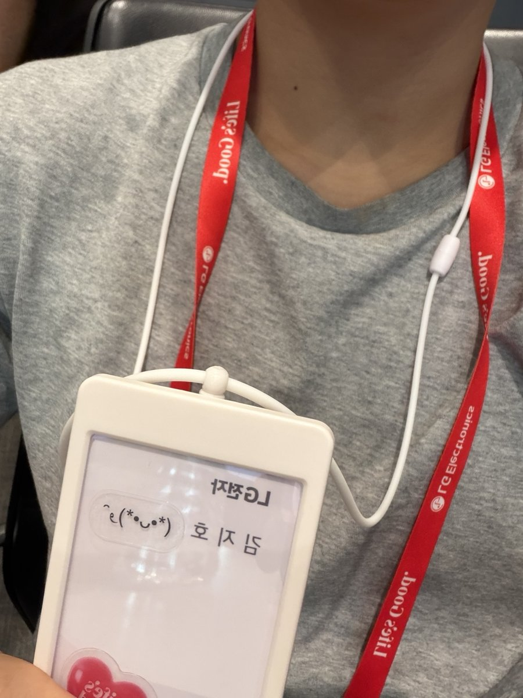
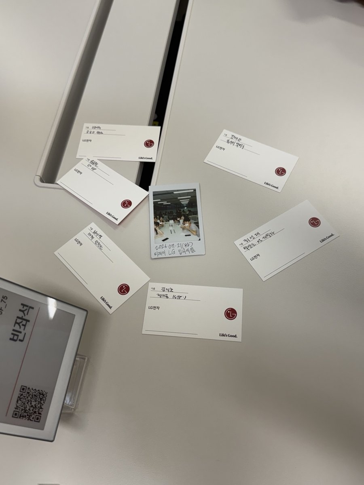
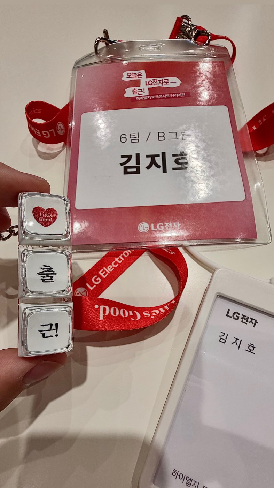
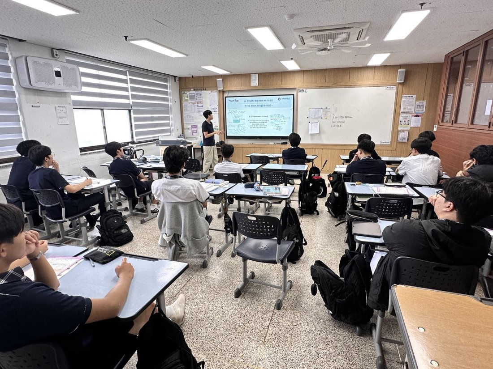
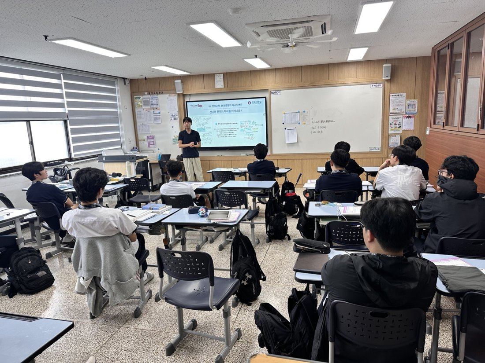
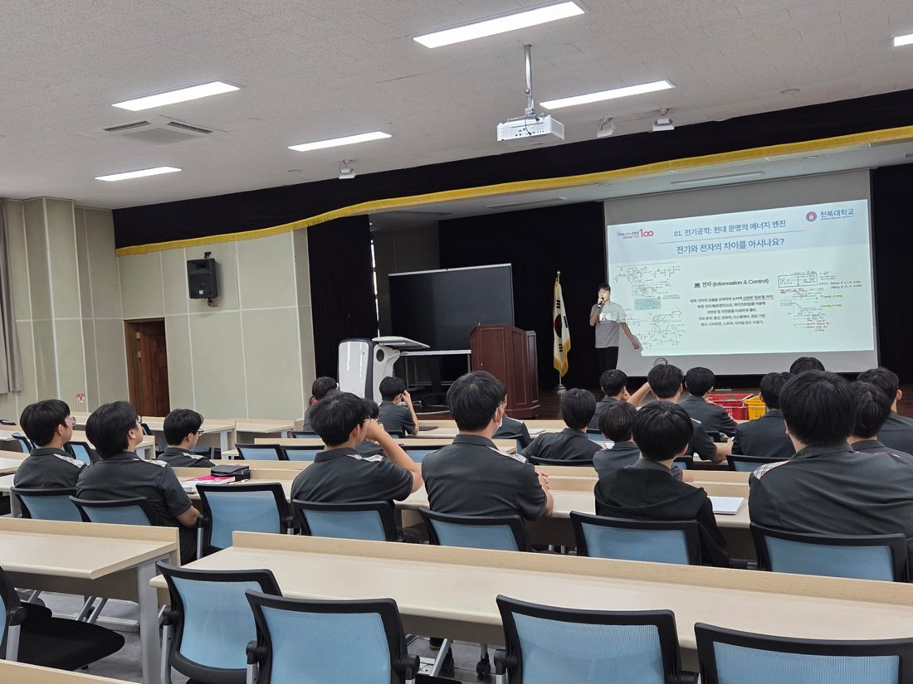
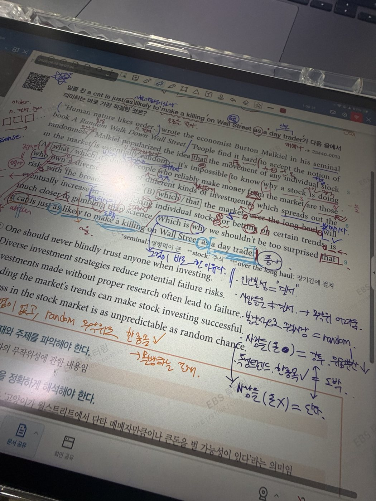
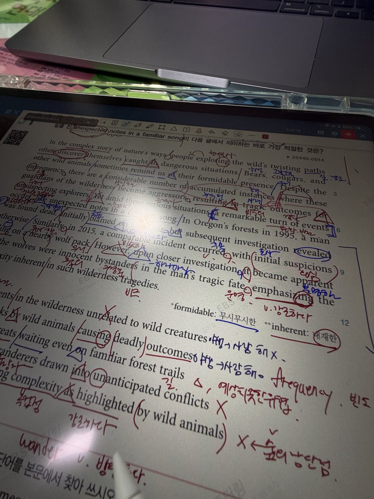
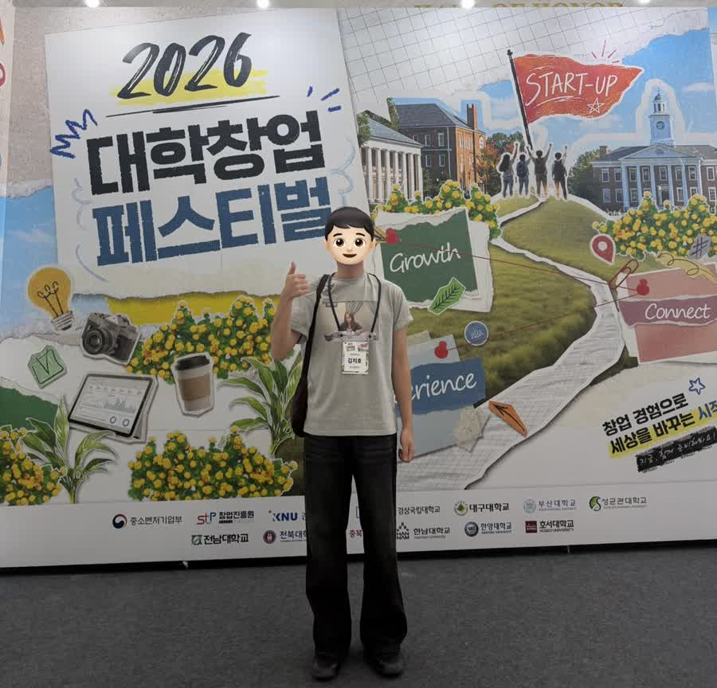

# 대외활동

| 활동 내용 | 기관·활동 |
| --- | --- |
| 초등학생 대상 교통안전 교육 진행 · 장학금 수혜 | 한국도로공사 전북본부 배움잇는 인턴십 · 2026년 여름방학 |
| 대학생 참가자 | LG전자 하이엘지 토크콘서트 커리어편 · 2026.07.21 |
| 창업팀 발표·질의응답 기록 및 사업성 분석 | [창업중심대학 대학창업페스티벌 · 2026.09.17](#startup-festival) |
| 전북대학교를 통해 학술대회 참관 · 제주국제컨벤션센터 | 2026 한국자동차공학회 춘계학술대회 · 2026.05.20–23 |
| 전북 지역 고등학생 대상 전기공학 전공 소개 및 진학 상담 | [전북대학교 전공알리GO 전공알림단 · 2026.07.01–08.28](#major-outreach) |
| 고1 영어 2명 · 중3 수학 1명 지도 | [EBS 튜터링 · 2026년 2학기 진행 중](#ebs-mentoring) |
| 학교 밖 청소년의 검정고시 학습 지도 | 학교밖청소년지원센터 |
| 진로·감정코칭 프로그램 진행 보조 | 김제시청소년상담복지센터 |
| 센터 아동 학습 보조 | 김제시다함께돌봄센터 |
| 팀장으로 중국인 학생 2명과 매주 스터디 진행 | 전북대학교 글로벌 스터디그룹 · 2026년 1학기 |

## LG전자 하이엘지 토크콘서트

**커리어편 · 2026.07.21 · 대학생 참가자**

LG전자 하이엘지 토크콘서트에 참여해 현직자와 만나 직무 이야기를 듣고, CLOi 로봇을 관람했습니다.

## 전공알리GO 전공알림단

**전북대학교 · 2026.07.01–08.28**

전북 지역 고등학교를 방문해 학생들에게 전기공학 전공을 소개하고 진학 상담을 진행했습니다. 교실과 강당에서 발표자료를 활용해 전기와 전자의 차이, 전기공학에서 배우는 내용을 설명했습니다. 전공 용어를 처음 접하는 고등학생도 이해할 수 있도록 회로·제어 등 학습 내용과 실제 활용 분야를 연결해 전달했습니다.

## EBS 튜터링 · 고1 영어 멘토링

고1 학생의 영어 수업을 진행하며 지문의 문장 구조, 어휘, 해석과 문법을 함께 설명했습니다. 태블릿에 지문을 띄워 관계사·접속사와 수식 관계를 표시하고, 문장을 의미 단위로 나누어 읽도록 지도했습니다. 단어 뜻만 옮기기보다 문장 사이의 연결과 글의 핵심 의미를 이해하도록 필기와 해설을 준비했습니다.

## 대학창업페스티벌

**2026 대학창업페스티벌 · 2026.09.17 · 창업팀 발표·질의응답 분석**

여러 창업팀의 발표와 질의응답을 들으며, 문제를 어떻게 설명하고 실제 고객의 수요를 어떤 근거로 보여주는지 메모했습니다. 발표 순서를 기록하는 데서 더 나아가, 제품이 필요한 이유와 실제 사업으로 운영할 수 있는지를 나누어 살펴봤습니다.

| 분석 관점 | 메모하며 확인한 내용 |
| --- | --- |
| 발표 구성 | 문제 인식에서 제품 소개, 시장·경쟁 분석, 현장 검증, 확장 전략으로 이어지는 설명 흐름 |
| 고객 검증 | 인터뷰, 시제품, 실제 사용과 구매 의향 중 어떤 근거로 수요를 설명하는지 |
| 사용자와 구매자 | 서비스를 쓰는 사람과 비용을 지불하는 사람이 같은지, 기관 도입에는 누구의 요구가 중요한지 |
| 수익과 운영 | 가격·수수료·구독 구조가 인력과 운영 비용을 감당할 수 있는지, 자동화가 가능한 범위는 어디까지인지 |
| 실행의 제약 | 사용자 유입, 제작비, 유지관리와 확장 과정에서 생길 어려움을 어떻게 설명하는지 |

특히 질의응답에서 드러난 빈틈을 기록했습니다. “대상 사용자가 실제로 서비스를 이용하게 하려면 무엇이 필요한가”, “이용량이 늘어도 운영할 수 있는가”, “개발과 사업화가 어려운 이유는 무엇인가”를 중심으로 발표 내용과 답변을 비교했습니다.

이 경험을 통해 사업계획서를 볼 때 **문제의 크기뿐 아니라 고객이 사용할 이유, 비용을 지불할 주체, 실제 검증 근거와 운영 부담까지 확인해야 한다는 판단 기준**을 정리했습니다. 제 창업 아이디어를 점검할 때도 먼저 확인해야 할 질문들입니다.

[전체 포트폴리오](../README.md)
