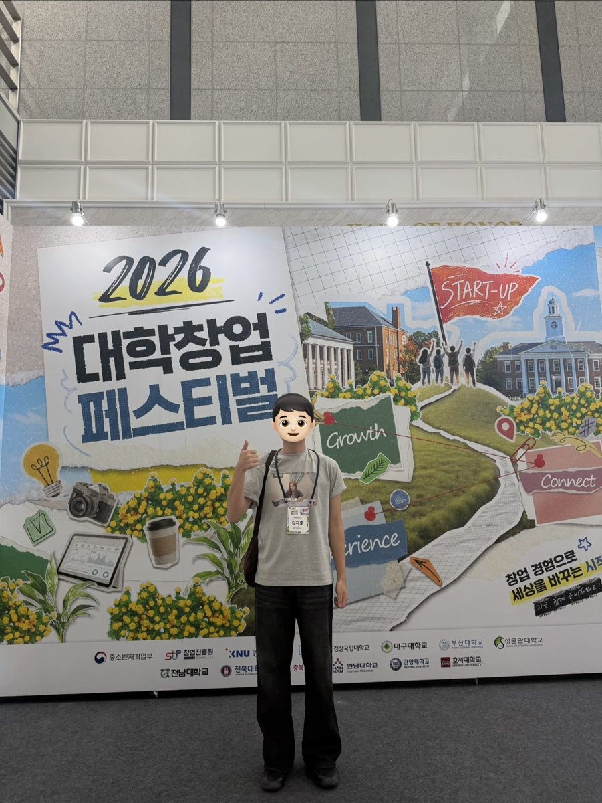

# 대외활동

| 활동 내용 | 기관·활동 |
| --- | --- |
| 초등학생 대상 교통안전 교육 진행 · 장학금 수혜 | 한국도로공사 전북본부 배움잇는 인턴십 · 2026년 여름방학 |
| 대학생 참가자 | LG전자 하이엘지 토크콘서트 커리어편 · 2026.07.21 |
| 참가 | 창업중심대학 대학창업페스티벌 · 2026.09.17 |
| 전북대학교를 통해 학술대회 참관 · 제주국제컨벤션센터 | 2026 한국자동차공학회 춘계학술대회 · 2026.05.20–23 |
| 전북 지역 고등학생 대상 전기공학 전공 소개 및 진학 상담 | 전북대학교 전공알리GO 전공알림단 · 2026.07.01–08.28 |
| 고1 영어 2명 · 중3 수학 1명 지도 | EBS 튜터링 · 2026년 2학기 진행 중 |
| 학교 밖 청소년의 검정고시 학습 지도 | 학교밖청소년지원센터 |
| 진로·감정코칭 프로그램 진행 보조 | 김제시청소년상담복지센터 |
| 센터 아동 학습 보조 | 김제시다함께돌봄센터 |
| 팀장으로 중국인 학생 2명과 매주 스터디 진행 | 전북대학교 글로벌 스터디그룹 · 2026년 1학기 |

## LG전자 하이엘지 토크콘서트

**커리어편 · 2026.07.21 · 대학생 참가자**

LG전자 하이엘지 토크콘서트에 참여해 현직자와 만나 직무 이야기를 듣고, CLOi 로봇을 관람했습니다.

## 대학창업페스티벌

**2026 대학창업페스티벌 · 2026.09.17 · 참가**

[전체 포트폴리오](../README.md)
