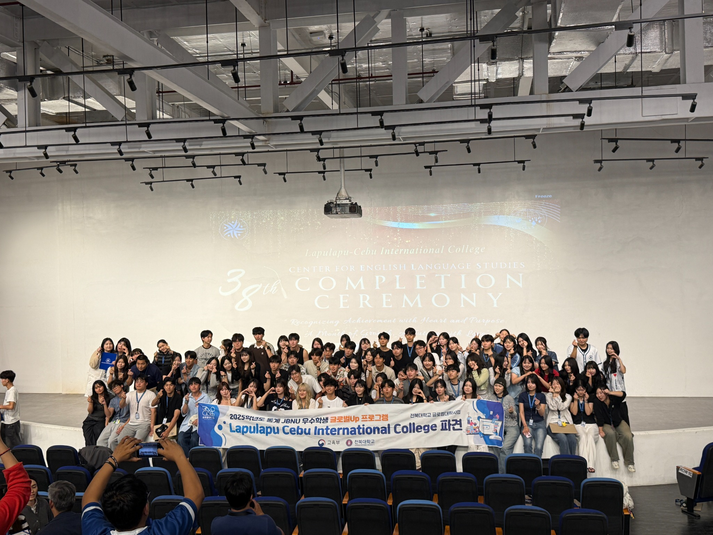
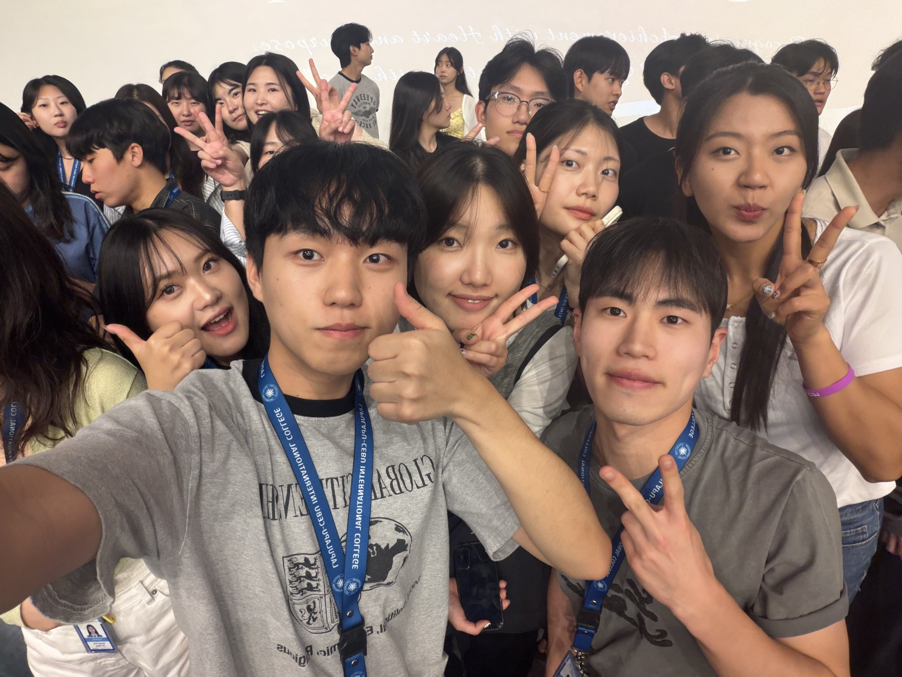
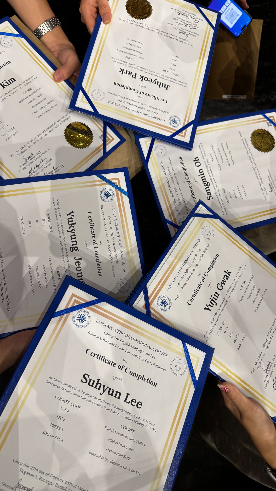

# 교육·연수

| 프로그램 | 이수·참여 내용 |
| --- | --- |
| 2025학년도 동계 JBNU 우수학생 글로벌Up 프로그램 | Lapulapu Cebu International College 파견 |
| 전북대학교 글로벌 스터디그룹 | [대외활동 기록](../activities/README.md) |
| 바이브 코딩 | 전북대학교 글로벌 스터디그룹 | [대외활동 기록](../activities/README.md) |
| 바이브 코딩 교육 참여 |
| AI 활용 영상 제작 전문 교육 | 2026.01.05–01.06 교육 참여 · 01.09 경진대회 우수상 |
| 학점은행제 | 경영 전공(경영전문학사 과정) · 인정 50학점(학습과정 30, 자격증 20) · 평점 4.3/4.5 · 최종 학점 인정일 2025.01.28 |

## 자격·시험

| 자격·시험 | 등급 |
| --- | --- |
| 한경 TESAT | 2급 |
| 매경TEST | 최우수 (840점) · 2025.01.10 취득 |
| 6시그마 | Green Belt |
| 비즈니스엑셀실무 | 2급 |

## 자격 관련 교육 수료

| 한국커리어개발원 과정 | 교육 기간 | 수료일 |
| --- | --- | --- |
| 제3기 6시그마 Green Belt | 2026.05.30–05.31 | 2026.05.31 |
| 제4기 비즈니스엑셀실무 | 2026.05.16–05.17 | 2026.05.17 |

### 세부 국제어학연수 사진

[전체 포트폴리오](../README.md)
