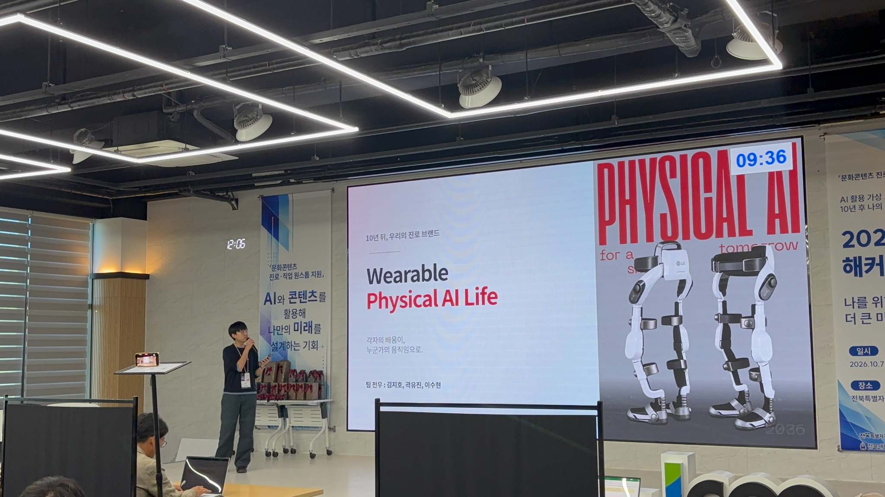
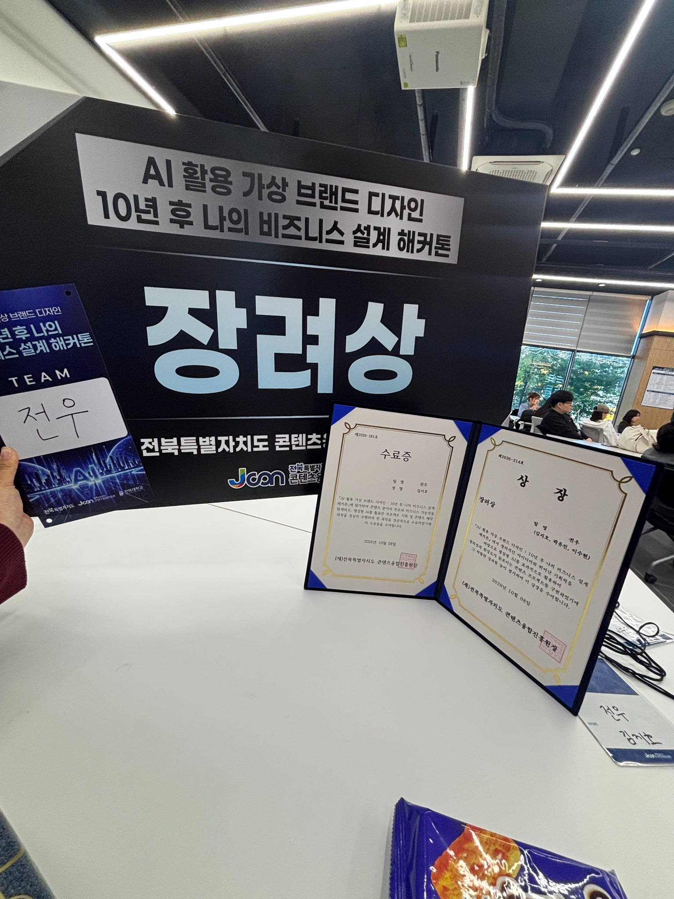

# AI 활용 가상 브랜드 디자인 해커톤

**Wearable Physical AI Life 영상·포스터 기획 및 발표 · 장려상**

**AI 문화콘텐츠 해커톤 장려상 · 팀 전우**

“할아버지가 좋아하는 산책을 계속하려면 무엇이 필요할까?”라는 질문에서 출발했습니다. 전기공학·스포츠과학·마케팅을 공부하는 팀원들이 2036년에 다시 만나 시니어의 보행을 돕는다는 이야기를 영상과 포스터로 기획해 발표했습니다.

제가 맡은 이야기의 중심은 센서와 모터였습니다. 센서로 사용자의 움직임을 읽고 모터가 필요한 만큼 힘을 보태는 모습을, CLOi 관찰 경험과 실제 모터제어 연구를 바탕으로 구상했습니다. 영상 속 팀원들은 제품을 혼자 입고 벗기 어렵다는 불편을 발견하고, 착용 도크와 해제 손잡이를 사용하는 장면으로 개선 방향을 보여줍니다.

발표자료에는 세 사람의 역할을 담은 70초 이야기와 AI 브랜딩 영상 「다시 만난 우리」, 광고 영상을 구성했습니다. 웨어러블 제품은 10년 뒤의 진로를 표현한 가상 설정입니다.

[전체 포트폴리오](../../README.md)

## 해커톤 현장

