# E-SynC! 학부생연구프로그램 성과발표회

**PMSM 전류제어 학부연구 프로젝트 · 팀장 · 최우수상**

**2026 E-SynC! 학부생연구프로그램 성과발표회 최우수상 · 팀장**

시뮬레이션에서 설계한 영구자석 동기전동기(PMSM) 전류제어기가 실제 인버터에서도 모터를 구동하는지 확인하는 학부연구입니다. 제어 모델에서 생성한 C 코드를 보드에 올렸지만 처음에는 모터가 회전하지 않았습니다. PWM 출력 파형을 측정해 L6398 게이트 드라이버의 입력 논리와 대조했고, 생성 코드의 PWM 극성을 수정한 뒤 구동을 확인했습니다.

## 연구 배경과 목표

**전기차와 산업용 구동기에 쓰이는 모터를, 시뮬레이션 설계에서 실제 하드웨어 구동까지 연결해 보고자 했습니다.** 영구자석 동기전동기(PMSM)는 전류의 크기와 방향에 따라 발생하는 토크가 달라지므로, 원하는 구동 성능을 얻으려면 전류를 지령에 맞게 제어하는 것이 기본입니다.

실험 환경을 구축할 때는 전용 실시간 장비인 RT Box의 도입 부담도 고려했습니다. PLECS에서 설계한 제어 모델을 자동으로 C 코드로 생성하고 STM32에 적용해, RT Box 없이도 모터·인버터를 연결해 전류제어를 시험하는 환경을 구성하는 것이 목표였습니다.

이 과정에서 확인하려던 것은 **“모델에서 동작한 제어기가 실제 보드에서도 같은 의도로 작동하는가?”**였습니다. 자동 생성 코드와 실제 게이트 드라이버의 PWM 논리, 전류 센싱, 엔코더 신호를 맞추고 전류 응답을 측정하는 데 연구의 초점을 두었습니다.

### 발표자료로 보는 연구 배경

<a href="assets/research-background.jpg">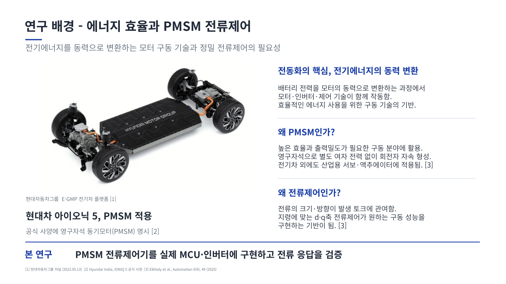</a>

<a href="assets/implementation-background.jpg">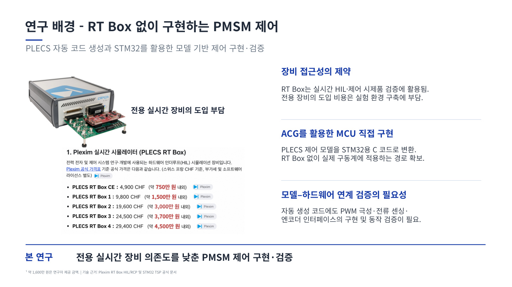</a>

*팀 발표자료 PDF 2·3쪽 발췌. 장비 가격 표기는 발표 당시 자료에 포함된 참고 내용입니다.*

## 선행연구 검토와 파형 분석

PMSM 초기 회전자 위치 검출과 제어기 구현에 관한 선행논문을 읽고, 시뮬레이션 모델을 실제 제어 장치와 연결하는 방법을 검토했습니다. 논문에 제시된 제어 흐름과 파형을 살펴보며 현재 실험의 전류 센싱·위치 검출·PWM 출력 과정과 비교했습니다.

### 데이터시트 분석 → PWM 확인 → 코드 수정 → 실측 검증

**모터가 회전하지 않는 문제를 게이트 드라이버의 입력 논리와 실제 PWM 출력의 불일치로 추적했습니다.** L6398 데이터시트의 입력 논리를 기준으로 자동 생성 코드의 출력 설정을 점검하고, 오실로스코프로 측정한 신호와 대조했습니다.

| 확인한 항목 | 수행한 작업과 판단 |
| --- | --- |
| 게이트 드라이버 입력 논리 | L6398의 입력 조건을 읽고 생성 코드의 PWM 극성과 대조 |
| 실제 PWM 출력 | 오실로스코프로 전압 레벨·주기·듀티와 신호 반전 관계 확인 |
| 구현 수정 | 드라이버 입력 논리에 맞게 생성 코드의 PWM 극성 수정 |
| 수정 후 동작 | 모터 회전 여부와 전류 응답을 다시 확인하고 측정 파형으로 기록 |

| 선행논문 검토 | PWM 파형 측정·비교 | 제어 보드와 프로브 연결 |
| --- | --- | --- |
| <a href="assets/literature-review.jpg">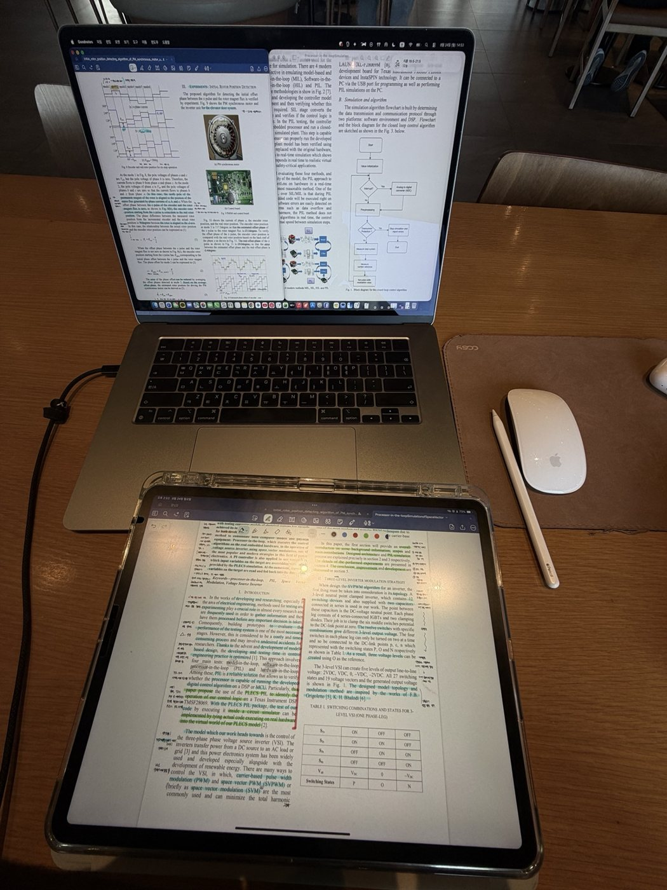</a> | <a href="assets/pwm-waveform.jpg">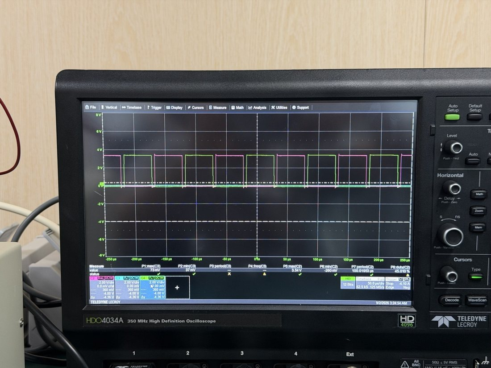</a> | <a href="assets/board-measurement.jpg">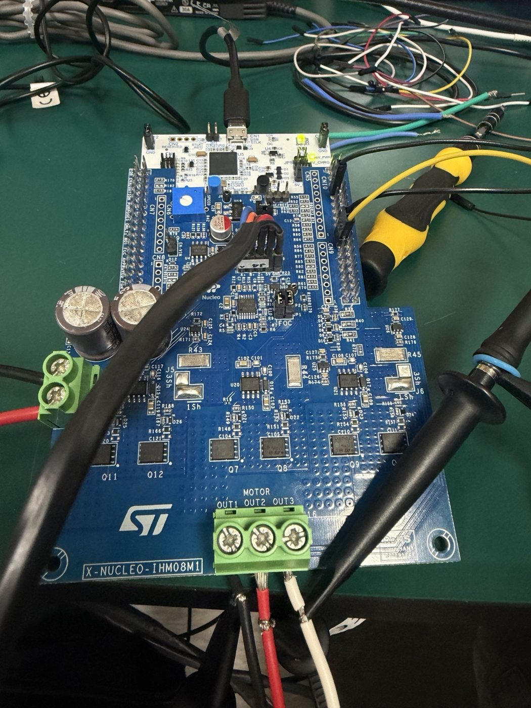</a> |

## 설계와 측정

STM32G431RB와 X-NUCLEO-IHM08M1 인버터로 Teknic M-2310P 모터를 구동했습니다. 세 상의 전류를 3-shunt 방식으로 측정하고 ADC 오프셋과 센싱 스케일을 적용했습니다. ABZ 엔코더에서 얻은 회전자 위치로 3상 전류를 회전자 기준의 d축·q축 전류로 변환했습니다. 두 축의 PI 제어기가 지령과 측정값의 차이를 계산하고, PWM으로 인버터에 인가할 전압을 조절하는 구조입니다.

DC 링크 40 V, 스위칭 주파수 10 kHz에서 정렬과 구동을 나눠 측정했습니다.

| 시험 구간 | 확인한 동작 |
| --- | --- |
| 회전자 정렬 | d축 전류가 약 1 A 지령을 추종하고 q축은 0 A 부근을 유지했습니다. 오실로스코프에서 세 상의 전류가 각각 약 +0.5 A, 0 A, −0.5 A로 유지되는 것을 확인했습니다. |
| 전류제어 모드 | d축 지령을 0 A, q축 지령을 약 1 A로 바꾼 뒤 모터가 회전했습니다. 세 상의 전류는 약 120° 위상차를 갖는 정현파 형태였습니다. |

팀장으로 실험 과정과 측정 결과를 정리해 성과발표회에서 발표했습니다. 공동 연구진과 작성한 대한전기학회 추계학술대회 논문과 성과발표회 포스터에는 제어 구조, 자동 생성 코드의 수정 이유, 측정 파형을 담았습니다. 후속 연구 과제는 속도제어기를 추가하고 부하가 변할 때의 응답을 측정하는 것입니다.

[논문 원문 (PDF) · PLECS 시뮬레이션과 STM32를 활용한 모터 제어 시스템 구현](assets/kiee-2026-motor-control.pdf)

## 성과발표회 행사 안내

<a href="assets/esync-event-banner.jpg">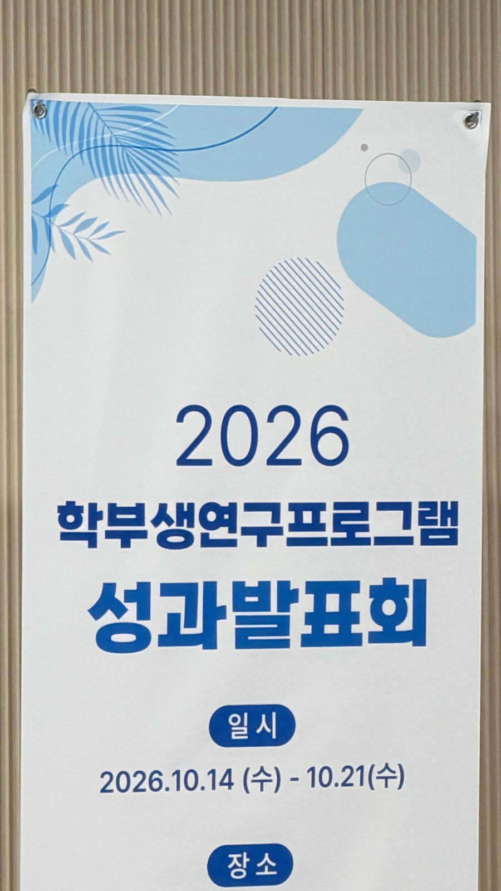</a>

## 학부연구 현장 사진

| 대한전기학회 추계학술대회 · 연구 포스터 | E-SynC! 학부생연구프로그램 성과발표회 · 최우수상 |
| --- | --- |
| <a href="assets/kiee-poster.jpg">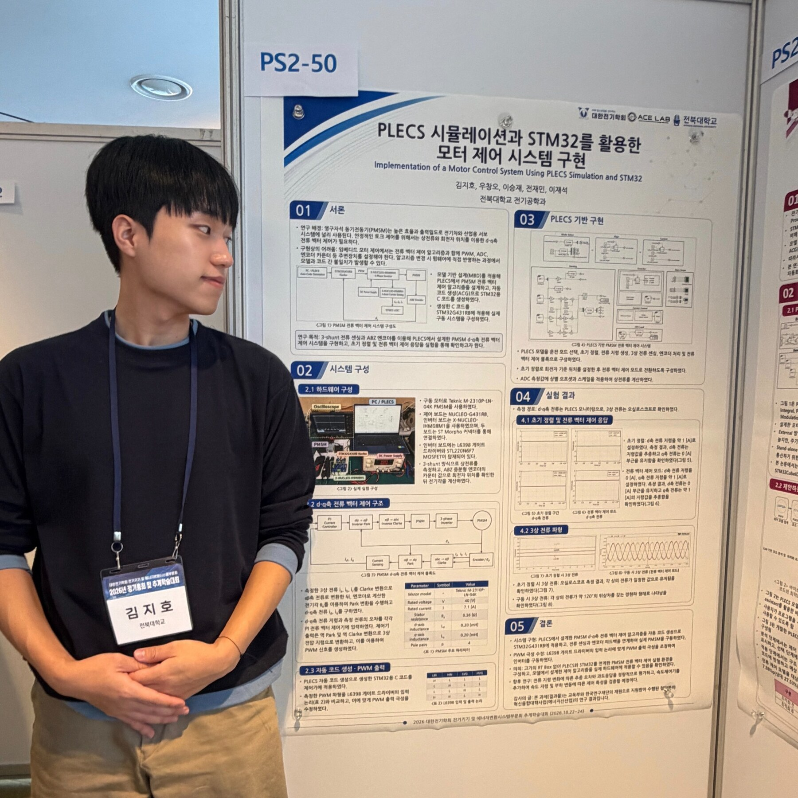</a> | <a href="assets/esync-award.jpg">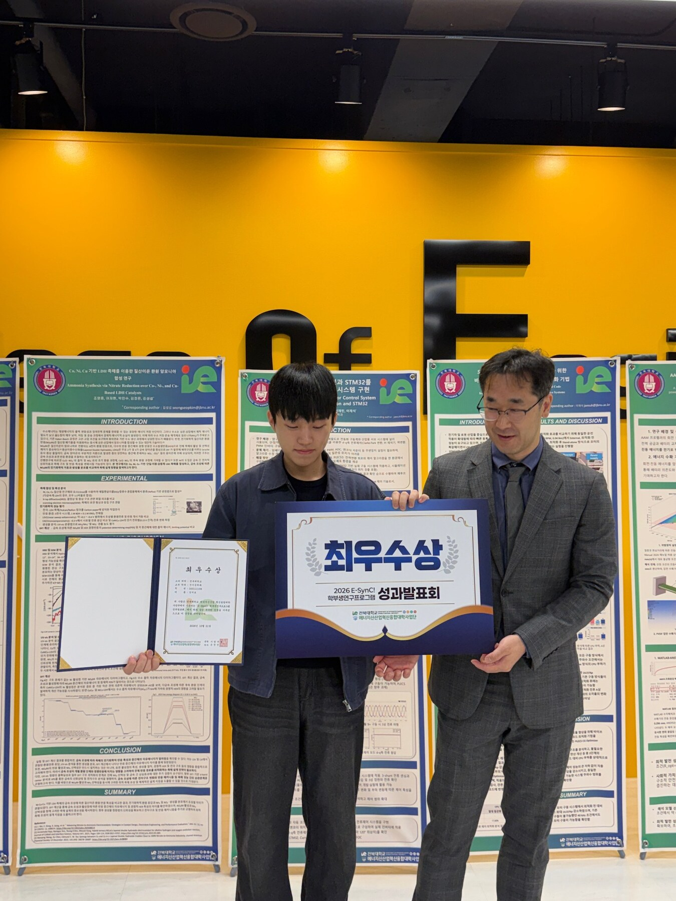</a> |

## 성과발표회 발표와 연구자료

<a href="assets/esync-poster-presentation.jpg">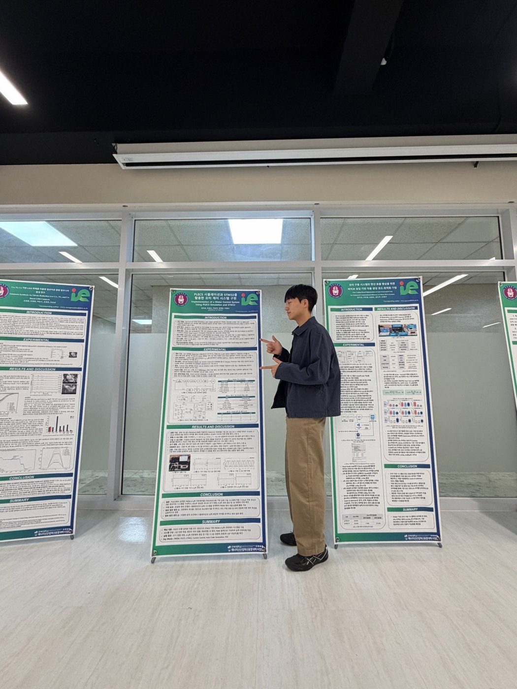</a>

### 전체 제어 시스템

<a href="assets/system-overview.jpg">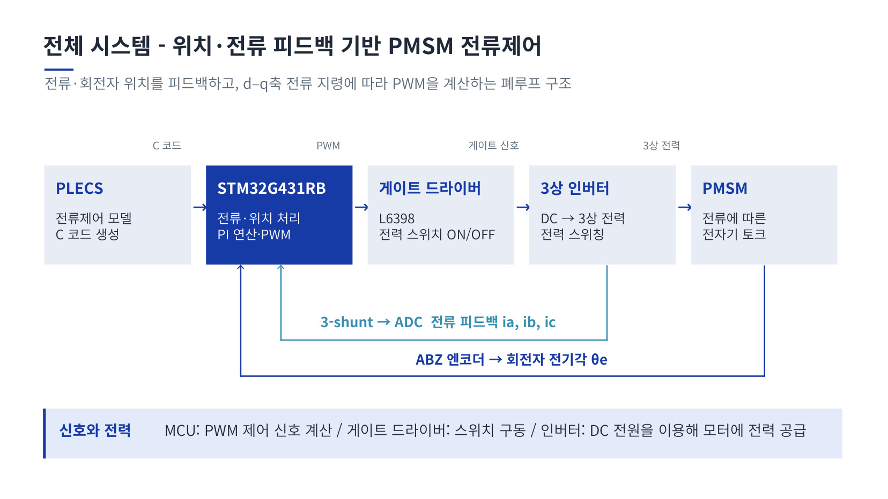</a>

### 실험 환경과 측정 조건

<a href="assets/experiment-setup.jpg">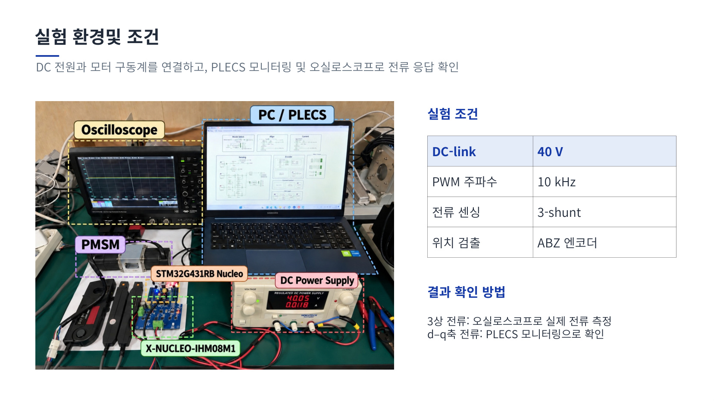</a>

### 전류 응답과 실제 측정 파형

<a href="assets/dq-current-response.jpg">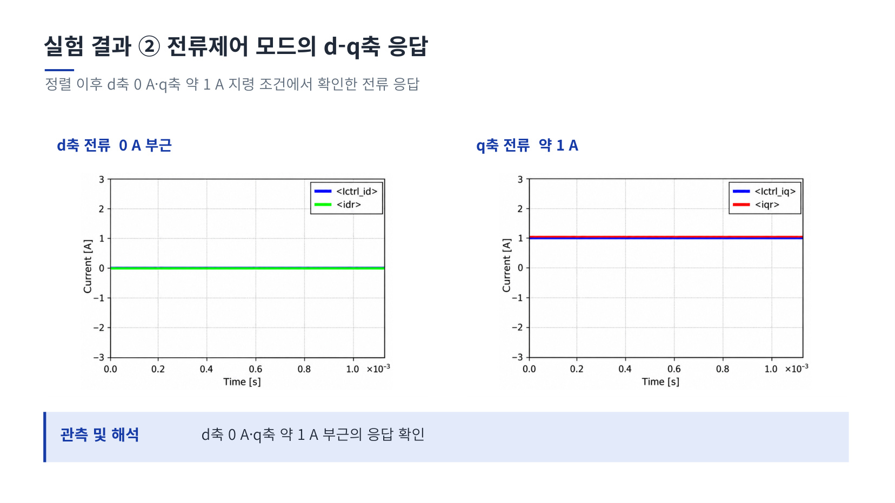</a>

<a href="assets/three-phase-current-original.jpg">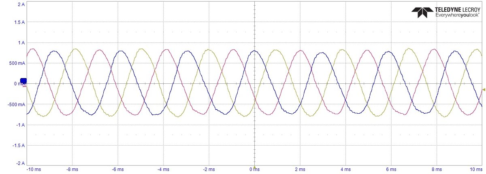</a>

세 채널의 전류가 주기적으로 변하고 서로 위상차를 갖는 모습을 확인했습니다. 같은 종류의 파형 사진은 대표 1장만 제시했습니다.

### 계측 화면에서 확인한 신호

<a href="assets/scope-signal-review.jpg">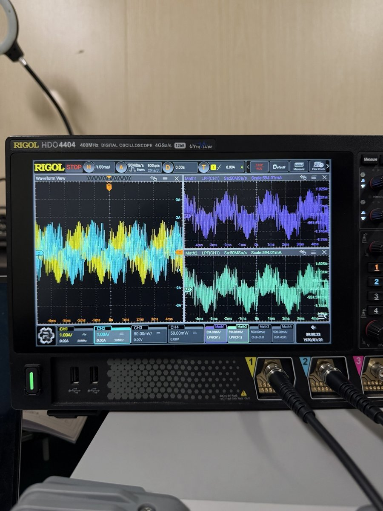</a>

원 신호와 오실로스코프의 LPF 수학 채널 표시를 함께 살펴보며 파형을 해석했습니다. 이 화면의 필터 표시는 계측기 기능이며, 제어 코드에 필터를 구현했다는 의미로 제시하지 않습니다.

이미지 출처: 팀 학부연구 발표자료 「E-SynC PMSM 전류제어 2차 (2)(1)」의 PDF 5·8·14쪽. 전체 시스템, 실험 조건과 d–q축 응답을 발췌했습니다. 3상 전류와 추가 계측 화면은 직접 측정한 원본 사진입니다.

[전체 포트폴리오](../../README.md)
