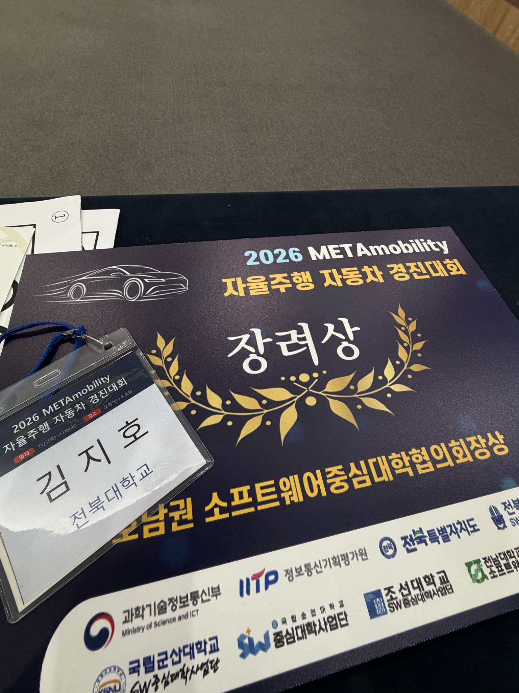
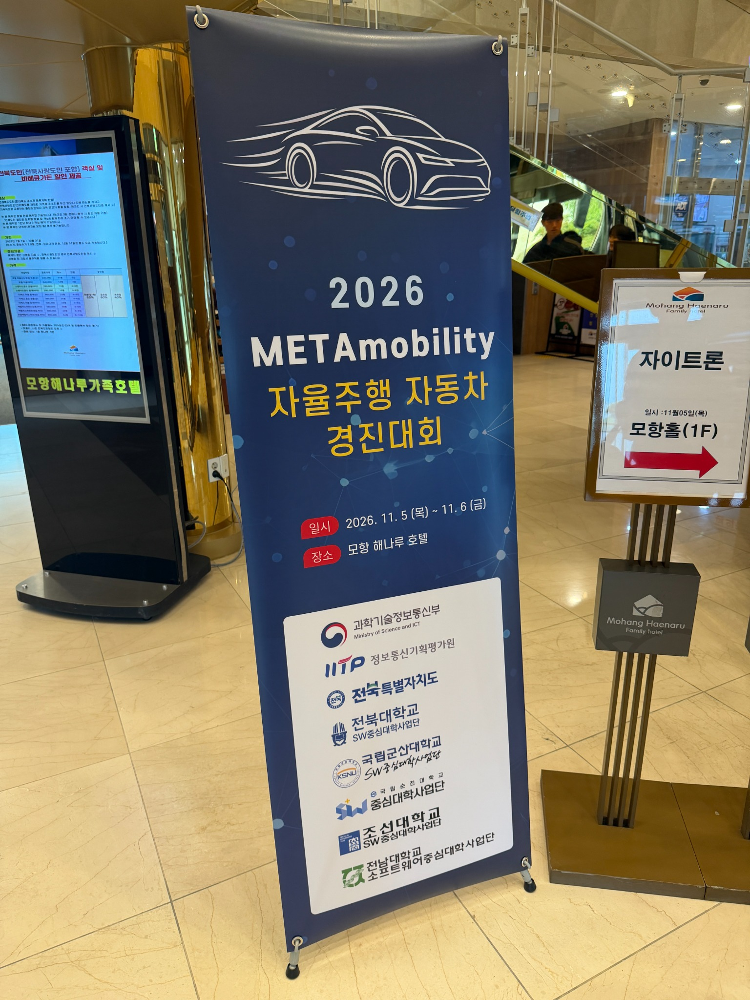

# 2026 METAmobility 자율주행 자동차 경진대회

**자이카 카메라·초음파 인식 및 실차 시험 · 장려상**

**2026년 11월 5~6일 모항해나루 호텔에서 열린 대회에서 장려상을 받았습니다.**

자이카에 카메라와 초음파 센서를 사용해 기본 주행 3회와 AI 주행 2회로 구성된 트랙을 준비했습니다. 현장에서는 주행 파일을 유지하고 인식 모듈을 수정하며 신호등 출발, 차선 추종, 라바콘 통과, AR 표지 인식을 시험했습니다.

- 출발 신호는 세 원 중 오른쪽 등이 밝아지는 순간입니다. 카메라 노출과 허프 원 검출 반지름을 조정하고, 출발한 뒤에도 차량이 계속 주행하도록 신호 처리 방식을 점검했습니다.
- 첫 회차 S자 구간에서 속도가 빠르면 AR 표지를 놓쳤습니다. 해당 구간의 속도 명령을 12로 낮추고, 마지막 표지를 지난 뒤 급우회전에서 차선을 다시 잡는 문제를 추적했습니다.
- AI 주행에서는 노란 횡단보도 주변의 장애물을 기준으로 오른쪽 회피, 직진, 차선 복귀 순서를 설계했습니다. 현장 시험에서 드러난 차선 이탈과 장애물 회피 후 차선 재인식이 주요 개선 과제였습니다.

## 수상 및 현장 사진

[전체 포트폴리오](../../README.md)

## 대회 영상

[직접 제작한 57초 현장 브이로그 보기](https://raw.githubusercontent.com/zxvxh/zxvxh/main/projects/METAmobility_자율주행_자동차_경진대회/assets/competition-vlog.mp4)
