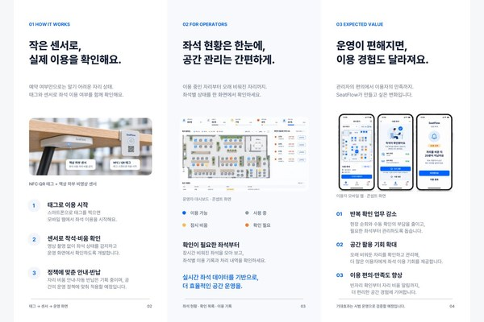
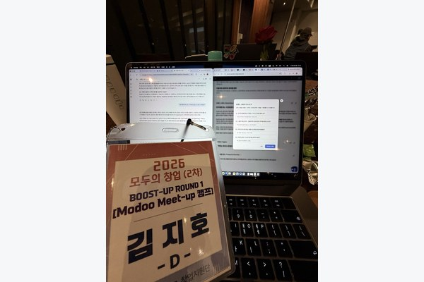
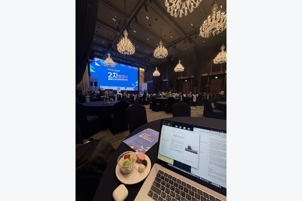
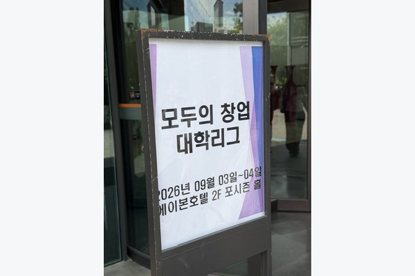
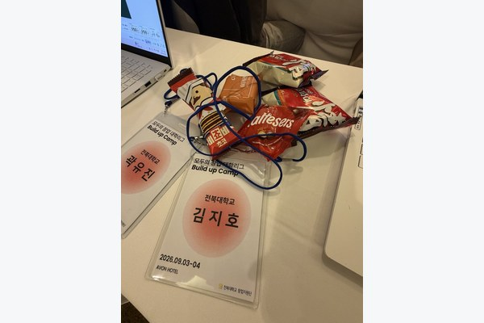

# SeatFlow

SeatFlow는 도서관이나 스터디카페에서 빈자리를 휴대폰으로 찾을 수 있는 서비스입니다. 학생은 앱 설치 없이 빈자리를 확인하고, 관리자는 좌석 배치도에서 어느 자리가 얼마나 오래 비어 있는지 볼 수 있습니다.

**대표 · 김지호**

[SeatFlow 웹사이트](https://seatflow.site.aiapp.help/) · [학생 화면 체험](https://seatflow.site.aiapp.help/student) · [관리자 화면 체험](https://seatflow.site.aiapp.help/experience)

현재 체험 화면은 예시 좌석 데이터를 사용합니다.

## 모두의 창업 진행 현황

중소벤처기업부 「모두의 창업」에 참여해 좌석 센서 시제품 제작과 도입 비용을 중심으로 멘토링을 이어가고 있습니다.

| 구분 | 진행 내용 |
| --- | --- |
| 사업화 모델 | 대학·스터디카페에 좌석 장치를 설치할 때의 설치비와 좌석당 이용료를 검토 중입니다. |
| 시제품 제작 | 착석 여부를 감지해 웹에 표시하는 시제품을 만들기 위해 제작 업체들과 상담 중입니다. |

### 모두의 창업 활동 사진

| | |
| --- | --- |
|  |  |

### 모두의 창업 대학리그 · 예선 통과 후 교육 참여

**Build up Camp · 2026.09.03–04 · AVON HOTEL**

모두의 창업 대학리그 예선을 통과해 후속 교육인 Build up Camp에 참여했습니다. 일반트랙 활동과 별도로, 대학리그 선발 이후 창업 아이디어를 구체화하는 교육 과정에 참여한 경험입니다.

| | |
| --- | --- |
|  |  |

## 창업 성과

| 프로그램 | 결과 |
| --- | --- |
| 제9회 청년벤처클럽 아이디어 경진대회 | 최우수상 |
| 모두의 창업 일반트랙 | 1라운드 통과 · 활동자금 200만 원 확보 |

[김지호 포트폴리오](../../README.md)
