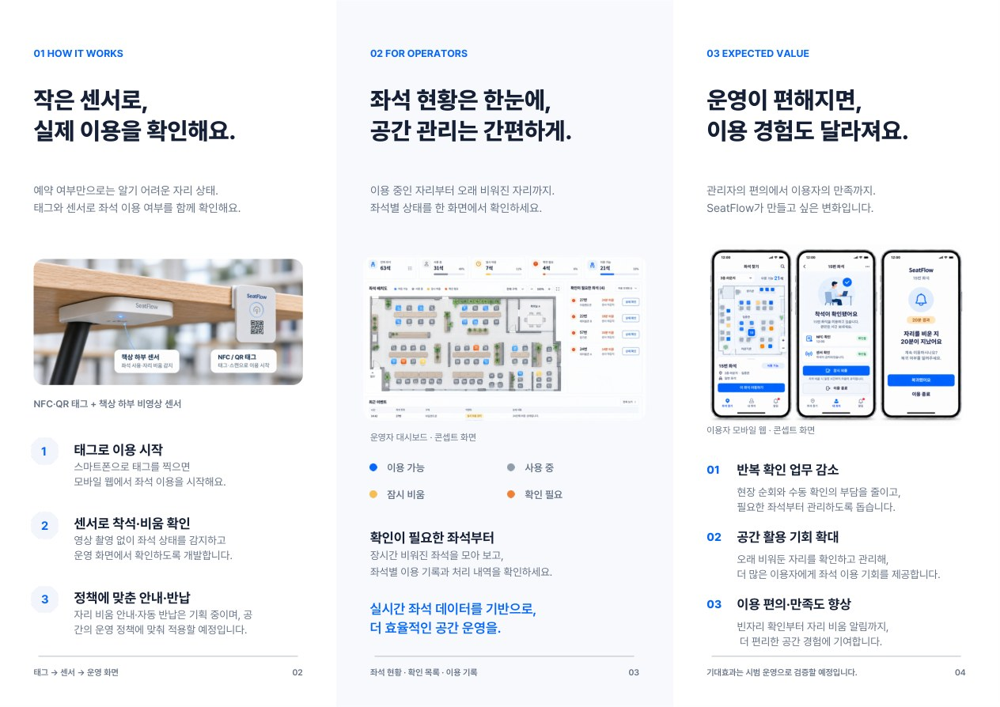

# SeatFlow

**도서관·스터디카페 좌석 관리 서비스 | 김지호 · 대표**

[학생용 웹 체험](https://seatflow.site.aiapp.help/student) · [운영자용 웹 체험](https://seatflow.site.aiapp.help/experience)

## 해결하려는 문제

예약 화면에는 ‘이용 중’이라고 뜨지만 책상에는 가방만 남아 있습니다. 학생은 자리를 써도 될지 망설이고, 관리자는 빈자리를 확인하려고 CCTV를 보거나 직접 돌아다녀야 합니다.

## 직접 만든 것

| 결과물 | 확인할 수 있는 내용 |
| --- | --- |
| 학생용 모바일 웹 | 앱 설치 없이 좌석 선택, 이용 시작, 자리 비움, 복귀 체험 |
| 운영자 대시보드 | 63석 배치도에서 좌석별 상태, 자리를 비운 시간, 이용 기록 확인 |
| 로고·리플렛 | 학생과 관리자가 각각 어떤 화면을 사용하는지 설명하는 시연 자료 |

학생 화면에서 **23번 좌석**을 선택해 자리를 비웠다가 복귀해 보세요. 운영자 화면에서는 **27번 좌석**의 비움 상태와 기록을 확인할 수 있습니다. 두 화면은 예시 데이터를 사용합니다.

## 실물 시제품 검증 계획

좌석의 QR을 스캔하면 이용을 시작하고, 책상 아래 센서가 감지한 착석 상태를 ESP32로 웹에 전달하는 구조입니다. 첫 시험에서는 가방만 놓인 자리와 사람이 움직이지 않고 앉아 있는 자리를 구분할 수 있는지 확인할 예정입니다.

## 창업 성과

| 프로그램 | 결과 |
| --- | --- |
| 제9회 청년벤처클럽 아이디어 경진대회 | 최우수상 |
| 모두의 창업 일반트랙 | 1라운드 통과 · 활동자금 200만 원 확보 |

[김지호 포트폴리오](../../README.md)
