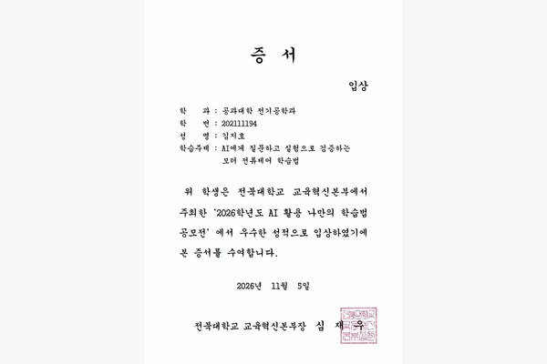

# 전북대학교 AI 활용 나만의 학습법 공모전

**AI의 답변을 모터 전류 측정으로 검증한 학습 과정 · 입상**

**2026학년도 AI 활용 나만의 학습법 공모전 · 전북대학교 입상**

PMSM 구동 실험에서 모르는 점을 AI에 질문하고, 답변으로 얻은 원인 후보를 실제 파형과 측정값으로 검증하는 공부 방법을 정리했습니다. 예를 들어 모터가 돌지 않을 때 PWM 출력과 인버터 게이트 신호의 극성을 대조하고, 코드를 수정한 뒤 모터가 회전하는지 확인했습니다. 질문부터 실험 결과까지 이어지는 과정을 학습과정 요약서와 발표자료에 담았습니다.

## 입상 증서

**전북대학교 교육혁신본부 · 2026.11.05 · 입상**  
학습주제: 「AI에게 질문하고 실험으로 검증하는 모터 전류제어 학습법」

[관련 PMSM 학부연구](../E-SynC_학부생연구프로그램_성과발표회/README.md) · [전체 포트폴리오](../../README.md)
