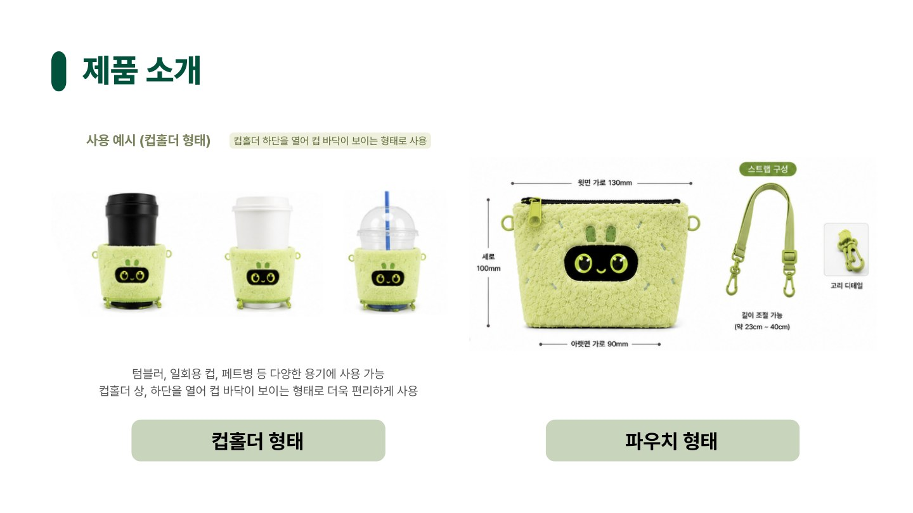
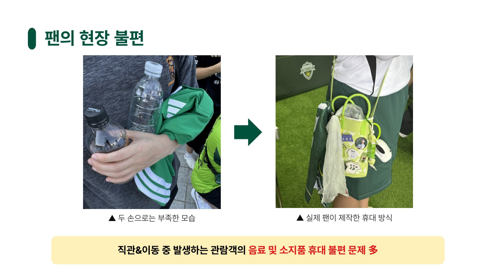
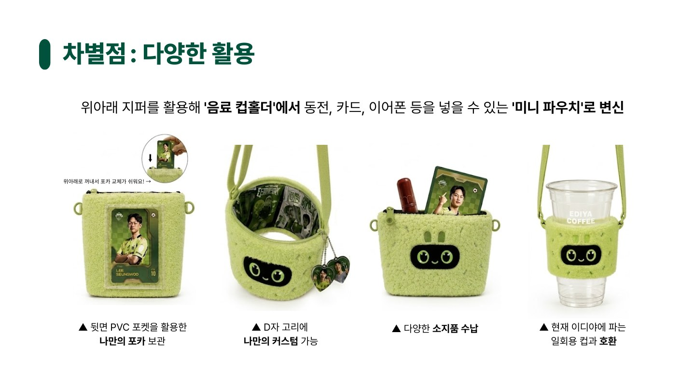

# 전북현대모터스 Drive Up

**나이티 드링크 파우치 · 팀장 · 우수상**

경기장에서 음료와 소지품을 함께 들기 어려운 팬의 불편을, 구단 폐현수막을 활용한 캐릭터 굿즈로 해결하고자 했습니다. 팀장으로 상품기획과 발표를 맡아 사용자 불편, 제품 구조, 제작 가능성, 판매 계획을 하나의 제안으로 정리했고 **전북현대모터스 Drive Up 우수상**을 받았습니다.

*발표자료에 담은 디자인 시안과 사용 예시입니다.*

## 팬의 불편에서 상품의 쓰임을 정했습니다

현장 사진에는 음료와 소지품 때문에 두 손이 부족한 관람객, 직접 휴대 방식을 만들어 사용하는 팬의 모습이 담겨 있었습니다. 여기에 경기 후 버려지는 현수막과 일회용 컵 문제를 연결했습니다. 친환경 소재를 사용하는 것과 함께, 팬이 경기장과 일상에서 반복해서 쓸 이유를 만드는 것이 필요했습니다.

발표자료의 팬 조사에서는 **컵홀더 사용 불편 경험 97.8%, 일상에서도 사용 가능할 경우 구매 의향 93%, 폐현수막 업사이클링 이야기가 구매에 긍정적 영향 88.4%**로 정리했습니다. 실용성·디자인·구단의 이야기를 함께 담는 방향으로 상품을 구체화했습니다.

*위 수치는 당시 팀 발표자료에 기재된 조사 결과이며, 해당 슬라이드에는 조사 인원과 표본 구성 정보가 표시되어 있지 않습니다.*

## 컵홀더를 일상용 파우치로 전환했습니다

| 설계 요소 | 사용자가 얻는 가치 |
| --- | --- |
| 위·아래 지퍼 | 음료를 담는 컵홀더에서 카드·동전·이어폰을 보관하는 미니 파우치로 전환 |
| 탈부착 스트랩과 D자 고리 | 휴대 방식 조절 및 키링 등으로 커스텀 |
| 뒷면 투명 포켓 | 팬이 원하는 포토카드를 넣고 교체 |
| 상단 130 × 하단 90 × 높이 100 mm | 휴대성과 수납을 고려한 제품 규격 구체화 |
| 구단 캐릭터 나이티와 폐현수막 안감 | 구단의 정체성과 자원 재활용 이야기를 상품에 반영 |

타 구단의 텀블러·멀티 파우치와 가격, 대상 고객, 활용 방식을 비교했습니다. 경기장에서 음료를 휴대하고 경기 후에는 작은 소지품을 담을 수 있도록 쓰임을 넓혔습니다.

## 제작업체에 문의해 소재 적용 가능성을 확인했습니다

업사이클링 전문 업체를 조사하고, 폐현수막을 안감으로 쓸 수 있는지와 플리스 겉감에 봉제가 가능한지 문의했습니다. 발표자료에는 **큐클리프에서 김지호 앞으로 보낸 회신**을 근거로 담았습니다.

- 폐현수막 안감과 플리스 겉감의 조합으로 제작할 수 있다는 답변을 받았습니다.
- 제공받은 폐현수막은 상태가 좋은 부분을 선별해 활용할 수 있다는 의견을 확인했습니다.
- 생활방수 가능성은 소재에 따른 업체 의견으로 정리했습니다. 완제품의 성능시험 결과를 의미하지 않습니다.

이 과정을 통해 소재 아이디어를 제작 조건과 연결했습니다. 봉제 내구성, 소재 선별, 세척과 관리 방법은 추가로 확인할 과제로 정리했습니다.

## 원가와 판매 방식까지 제안했습니다

발표 당시 **200개 생산 기준 개당 예상 원가 14,000원, 제안 판매가 29,000원**으로 사업성을 검토했습니다. 전량 판매를 가정하면 예상 매출은 580만 원, 매출총이익은 300만 원입니다. 샘플 제작비·부가세·유통 수수료 등 추가 비용에 따라 실제 수익은 달라질 수 있습니다.

사전 홍보안 **GREEN 200**과 경기장 **MD 커스텀 부스**를 제안해, 팬이 제품의 업사이클링 이야기를 알고 자신만의 굿즈로 꾸미는 판매 경험을 구상했습니다.

*원가·판매가·매출은 발표 당시의 계획과 추정치입니다. 실제 생산·판매 실적으로 제시하지 않습니다.*

## 이 경험에서 보여준 역량

**팬의 불편을 상품 기능으로 바꾸고, 제작업체의 답변과 원가 검토를 통해 제안의 구체성을 높였습니다.** 팀장으로 상품 구성과 발표를 이끌며 사용자 관찰에서 제품 구조, 생산 조건, 판매 방식까지 이어지는 기획을 경험했습니다.

자료: 팀 「전우」의 Drive Up 발표자료 「수정1차 (4)」, 현장 사진·디자인 시안·업체 회신 포함. 팀원: 강보경·곽유진·김지호·이수현.

[전체 포트폴리오](../../README.md)
