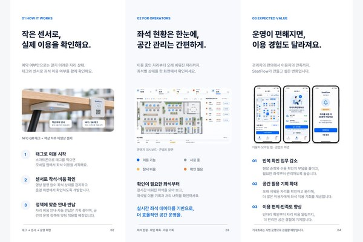

# 제9회 청년벤처클럽 아이디어 경진대회

**스마트 좌석 관리 서비스 SeatFlow · 대표 · 최우수상**

[SeatFlow 웹사이트](https://seatflow.site.aiapp.help/)

대표로서 도서관과 스터디카페의 좌석 관리 문제를 다루고 있습니다. 예약 화면에서 ‘사용 중’인 자리에 짐만 남아 있으면 학생은 앉아도 되는지 판단하기 어렵고, 관리자는 CCTV를 확인하거나 직접 자리를 찾아가야 합니다.

- **제작한 결과물** — 63석 가상 스터디카페의 운영자 화면과 학생용 모바일 웹을 제작했습니다. 운영자는 좌석을 눌러 비운 시간과 착석 기록을 보고, 학생은 정상 복귀·장기 부재·통신 오류 상황을 체험할 수 있습니다. 로고와 3단 리플렛도 제작해 인터뷰와 시연에 활용했습니다. [운영자 체험](https://seatflow.site.aiapp.help/experience) · [학생 체험](https://seatflow.site.aiapp.help/student)
- **실물 검증 계획** — 좌석 QR로 이용을 시작하고 책상 하부 센서의 착석 상태를 ESP32로 웹에 전달하는 시제품을 설계했습니다. 빈자리에는 파란 LED를 켜고 사용 중에는 끄는 방식입니다. 가방만 놓인 자리, 사람이 가만히 앉아 있는 자리, 통신이 끊긴 자리를 구분하는 것이 검수 과제입니다.
- **사업화** — SeatFlow로 제9회 청년벤처클럽 아이디어 경진대회에서 **최우수상**을 받았습니다. 모두의 창업 일반트랙 1라운드를 통과해 활동자금 200만 원을 확보하고 NEXT WAVE-UP에 사업계획을 제출했습니다. 대학에는 장치 일괄 공급을, 스터디카페에는 설치비와 좌석당 월 관리비를 적용하는 안을 검토하고 있습니다.

[전체 포트폴리오](../../README.md)

## 좌석 관리 웹 체험

[학생으로 체험하기](https://seatflow.site.aiapp.help/student) — 23번 좌석에서 이용 시작, 자리 비움, 복귀를 순서대로 확인할 수 있습니다.

[운영자로 체험하기](https://seatflow.site.aiapp.help/experience) — 63석 배치도에서 27번 좌석을 선택해 장시간 비움 표시와 이용 기록을 확인할 수 있습니다. 두 화면은 예시 데이터로 동작합니다.

