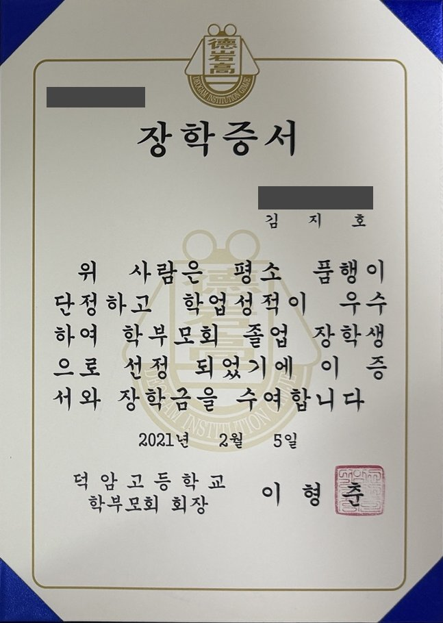
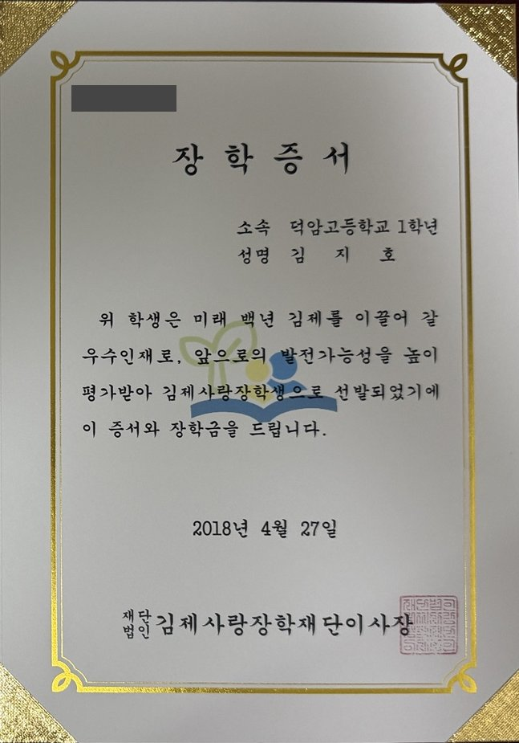
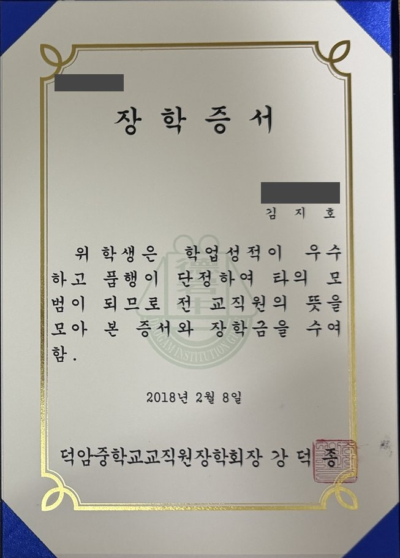
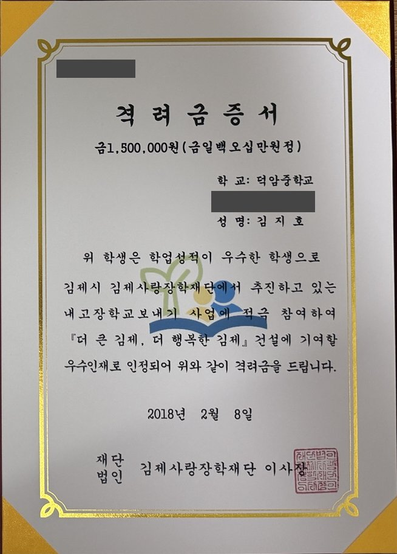
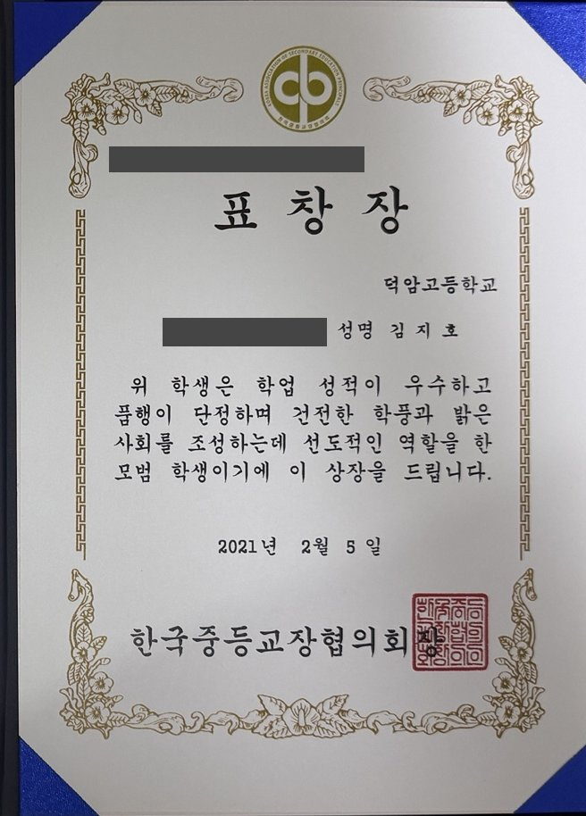
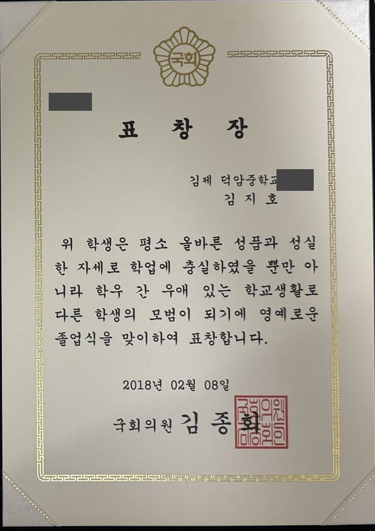

# 학창 시절 기록

[포트폴리오 홈](../README.md)

중·고등학교에서 받은 장학증서, 격려금 증서와 표창장을 모았습니다. 사진을 누르면 증서를 크게 볼 수 있습니다.

## 장학증서·격려금 증서

| 기록 | 학교·수여일 및 내용 | 증서 사진 |
| --- | --- | --- |
| **학부모회 졸업 장학증서** | 덕암고등학교 · 2021.02.05 학업 성적과 품행을 인정받아 학부모회 졸업 장학생으로 선정 |  |
| **김제사랑장학재단 장학증서** | 덕암고등학교 · 2018.04.27 고등학교 1학년 때 김제사랑장학생으로 선발 |  |
| **교직원장학회 장학증서** | 덕암중학교 · 2018.02.08 학업 성적과 품행을 인정받아 교직원장학회 장학금 수혜 |  |
| **김제사랑장학재단 격려금 증서** | 덕암중학교 · 2018.02.08 학업 성적과 ‘내 고장 학교 보내기’ 사업 참여를 바탕으로 격려금 150만 원 수혜 |  |

## 표창장

| 기록 | 학교·수여일 및 내용 | 증서 사진 |
| --- | --- | --- |
| **한국중등교장협의회 표창장** | 덕암고등학교 · 2021.02.05 우수한 학업 성적과 모범적인 학교생활로 표창 |  |
| **김종회 국회의원 표창장** | 덕암중학교 · 2018.02.08 성실한 학업 태도와 모범적인 학교생활로 졸업식에서 표창 |  |
